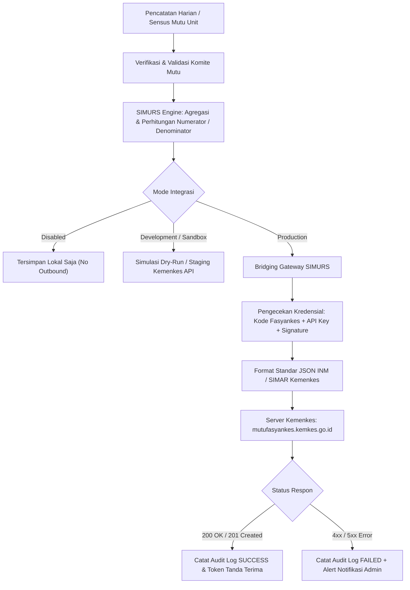

# Panduan Integrasi & Bridging INM & SIMAR Kemenkes — SIMURS

Dokumen ini berisi panduan teknis dan operasional untuk menghubungkan **Sistem Informasi Manajemen Mutu Rumah Sakit (SIMURS)** dengan **Sistem Pelaporan Indikator Nasional Mutu (INM) Kementerian Kesehatan RI** dan **SIMAR Kemenkes** (Sistem Informasi Manajemen Akreditasi Rumah Sakit).

---

## Daftar Isi
1. [Dasar Hukum & Pendahuluan](#1-dasar-hukum--pendahuluan)
2. [Arsitektur Sistem & Alur Kerja Bridging](#2-arsitektur-sistem--alur-kerja-bridging)
3. [Prasyarat & Konfigurasi Kredensial](#3-prasyarat--konfigurasi-kredensial)
4. [Tabel Pemetaan 13 Indikator Nasional Mutu (INM-01 s/d INM-13)](#4-tabel-pemetaan-13-indikator-nasional-mutu-inm-01-sd-inm-13)
5. [Spesifikasi Teknis API & Format Payload JSON](#5-spesifikasi-teknis-api--format-payload-json)
6. [Tingkatan Mode Integrasi (Environment)](#6-tingkatan-mode-integrasi-environment)
7. [Prosedur Simulasi & Uji Coba (Dry-Run)](#7-prosedur-simulasi--uji-coba-dry-run)
8. [Audit Trail & Log Integrasi](#8-audit-trail--log-integrasi)
9. [Panduan Penanganan Kendala (Troubleshooting) & FAQ](#9-panduan-penanganan-kendala-troubleshooting--faq)

---

## 1. Dasar Hukum & Pendahuluan

### 1.1 Dasar Hukum
1. **Peraturan Menteri Kesehatan Republik Indonesia Nomor 30 Tahun 2022** tentang *Indikator Nasional Mutu Pelayanan Kesehatan Tempat Praktik Mandiri Dokter dan Dokter Gigi, Klinik, Pusat Kesehatan Masyarakat, Rumah Sakit, Laboratorium Kesehatan, dan Unit Transfusi Darah*.
2. **Keputusan Direktur Jenderal Pelayanan Kesehatan Nomor HK.02.02/I/3991/2022** tentang *Petunjuk Teknis Pengukuran dan Evaluasi Indikator Nasional Mutu Pelayanan Kesehatan di Rumah Sakit*.
3. Kebijakan Satu Data Kesehatan & Integrasi Ekosistem Digital **SATUSEHAT** Kementerian Kesehatan Republik Indonesia.

### 1.2 Tujuan Integrasi
- Menghilangkan proses entri data ganda (*double entry*) oleh komite mutu rumah sakit.
- Menjamin validitas, integritas, dan ketepatan waktu pengiriman laporan capaian mutu bulanan ke server pusat Ditjen Pelayanan Kesehatan Kemenkes.
- Menyediakan riwayat pengiriman (*audit trail*) yang transparan dan dapat dipertanggungjawabkan saat asesmen akreditasi oleh lembaga independen (KARS, LAM-KPRS, LARS, dll.).

---

## 2. Arsitektur Sistem & Alur Kerja Bridging

Pengumpulan data mutu dilakukan secara desentralisasi oleh masing-masing unit kerja rumah sakit (Rawat Inap, Rawat Jalan, IGD, Kamar Operasi, Farmasi, Laboratorium, Radiologi, Rekam Medis, Gizi, PPI, dan K3RS). Setelah periode pelaporan bulanan ditutup dan divalidasi oleh Komite Mutu, data diagregasi dan dikirim ke server Kemenkes melalui RESTful API.

### 2.1 Diagram Alur Transmisi Data



### 2.2 Komponen SIMURS Terkait
Integrasi ini dikendalikan langsung oleh beberapa modul internal SIMURS:
- **Konfigurasi & Pengaturan**: [`frontend/js/pages/admin/settings.js`](file:///home/nanutdev/Dev/mutu-rsik-web/frontend/js/pages/admin/settings.js)
- **Settings Service**: [`backend/src/services/settings.service.js`](file:///home/nanutdev/Dev/mutu-rsik-web/backend/src/services/settings.service.js)
- **Settings Controller**: [`backend/src/controllers/settings.controller.js`](file:///home/nanutdev/Dev/mutu-rsik-web/backend/src/controllers/settings.controller.js)
- **API Routing**: [`backend/src/routes/settings.js`](file:///home/nanutdev/Dev/mutu-rsik-web/backend/src/routes/settings.js)
- **Katalog Master Indikator**: [`backend/src/config/indicators.config.js`](file:///home/nanutdev/Dev/mutu-rsik-web/backend/src/config/indicators.config.js)

---

## 3. Prasyarat & Konfigurasi Kredensial

Untuk dapat melakukan koneksi ke gerbang API Kemenkes, Administrator Rumah Sakit harus melengkapi parameter otentikasi resmi.

### 3.1 Data Kredensial Yang Diperlukan
| Parameter | Deskripsi | Contoh Nilai | Sumber Perolehan |
| :--- | :--- | :--- | :--- |
| **Kode Fasyankes** | Kode resmi rumah sakit dari DFO / Ditjen Pelayanan Kesehatan (7 digit). | `6371012` | Akun DFO / Registrasi Fasyankes |
| **INM Base URL** | Alamat endpoint API Indikator Nasional Mutu. | `https://mutufasyankes.kemkes.go.id/api/v1` | Portal Mutu Fasyankes |
| **INM API Key** | Kunci akses API publik untuk otentikasi fasyankes. | `inm_live_abcdef123456789...` | Menu Pengaturan Akun di Web INM |
| **INM Secret Key** | Kunci enkripsi untuk penandatanganan payload (HMAC-SHA256). | `sec_987654321fedcba...` | Menu Pengaturan Akun di Web INM |
| **SIMAR Base URL**| Alamat endpoint API SIMAR Akreditasi. | `https://simar-api.kemkes.go.id/v1` | Portal SIMAR Kemenkes |
| **SIMAR API Key** | Kunci akses pengiriman data mutu akreditasi SIMAR. | `simar_key_xyz987...` | Portal SIMAR Kemenkes |
| **SATUSEHAT Org ID**| Identitas organisasi rumah sakit di platform SATUSEHAT. | `10000004` | Portal SatuSehat Kemenkes |

### 3.2 Langkah Pengisian di SIMURS
1. Masuk ke aplikasi SIMURS menggunakan akun berhak akses **Super Administrator** atau **Admin Mutu**.
2. Buka menu navigasi sebelah kiri: **Pengaturan & Integrasi**.
3. Pilih tab **Mode Integrasi & API Key**.
4. Isi kolom:
   - **Mode Integrasi**: Pilih `Sandbox` (saat uji coba) atau `Production` (saat go-live).
   - **Kode Fasyankes**: Pastikan sesuai dengan kode RS resmi (misal: `6371012`).
   - **Endpoint & API Key INM Kemenkes**.
   - **Endpoint & API Key SIMAR Kemenkes**.
5. Klik tombol **Simpan Konfigurasi Integrasi**. Kredensial akan disimpan secara terenkripsi di tabel database `informasi_rumah_sakit`.

---

## 4. Tabel Pemetaan 13 Indikator Nasional Mutu (INM-01 s/d INM-13)

Sesuai standar Permenkes 30/2022, terdapat **13 Indikator Nasional Mutu (INM)** wajib bagi fasyankes rumah sakit. Sistem SIMURS telah mengintegrasikan pemetaan otomatis melalui preset resmi:

| Kode INM | Nama Indikator Resmi Kemenkes | ID Internal SIMURS | Standar Nasional | Satuan | Formula Numerator & Denominator |
| :---: | :--- | :--- | :---: | :---: | :--- |
| **INM-01** | Kepatuhan Kebersihan Tangan | `kepatuhan_kebersihan_tangan` | $\ge 85$ | % | **N:** Jumlah tindakan kebersihan tangan yang dilakukan.<br>**D:** Total seluruh peluang kebersihan tangan yang diamati. |
| **INM-02** | Kepatuhan Penggunaan Alat Pelindung Diri (APD) | `kepatuhan_apd` | $100$ | % | **N:** Petugas yang patuh memakai APD sesuai indikasi.<br>**D:** Total seluruh petugas yang diobservasi. |
| **INM-03** | Kepatuhan Identifikasi Pasien | `identifikasi_pasien` | $100$ | % | **N:** Proses identifikasi pasien yang dilakukan secara benar minimal 2 identitas.<br>**D:** Total kesempatan identifikasi pasien. |
| **INM-04** | Waktu Tunggu Rawat Jalan | `waktu_tunggu_poliklinik` | $\ge 80$ | % | **N:** Jumlah pasien rajal dengan waktu tunggu $\le 60$ menit.<br>**D:** Total seluruh pasien rawat jalan yang disampling. |
| **INM-05** | Penundaan Operasi Elektif | `penundaan_operasi` | $\le 5$ | % | **N:** Jumlah pasien operasi elektif yang mengalami penundaan $> 1$ jam.<br>**D:** Total seluruh pasien yang dijadwalkan operasi elektif. |
| **INM-06** | Kepatuhan Visite Dokter Spesialis | `visit_dokter` | $\ge 80$ | % | **N:** Jumlah pasien rawat inap yang divisite dokter spesialis antara pukul 06.00 – 14.00.<br>**D:** Total seluruh pasien rawat inap yang menjadi tanggung jawab DPJP. |
| **INM-07** | Kepatuhan Penggunaan Formularium Nasional | `kepatuhan_fornas` | $\ge 80$ | % | **N:** Jumlah item obat resep yang sesuai FORNAS.<br>**D:** Total item obat resep yang dilayani. |
| **INM-08** | Kepatuhan Terhadap Alur Klinis (Clinical Pathway) | `alur_klinis` | $\ge 80$ | % | **N:** Kasus CP terpilih yang penanganannya patuh terhadap alur klinis.<br>**D:** Total seluruh kasus penyakit yang masuk dalam evaluasi CP. |
| **INM-09** | Kepatuhan Upaya Pencegahan Risiko Pasien Jatuh | `risiko_jatuh` | $100$ | % | **N:** Pasien rawat inap berisiko jatuh yang dipasang intervensi pencegahan lengkap.<br>**D:** Total pasien rawat inap yang teridentifikasi berisiko jatuh. |
| **INM-10** | Waktu Tanggap Pelayanan Gawat Darurat (Emergency Response Time) | `emergency_response_time` | $\ge 80$ | % | **N:** Pasien triase gawat darurat yang ditangani dokter $\le 5$ menit.<br>**D:** Total seluruh pasien gawat darurat yang dilayani di IGD. |
| **INM-11** | Sisa Makanan Pasien Yang Tidak Termakan | `gizi_sisa_makanan` | $\le 20$ | % | **N:** Jumlah porsi makanan yang tersisa $> 20\%$ dari porsi yang disajikan.<br>**D:** Total seluruh porsi makanan yang disajikan kepada pasien. |
| **INM-12** | Kelengkapan Pengisian Rekam Medis 24 Jam Pasca Rawat Inap | `mutu_rekam_medis` | $100$ | % | **N:** Berkas rekam medis rawat inap yang terisi lengkap dan ditandatangani dalam waktu $\le 24$ jam setelah pulang.<br>**D:** Total berkas rekam medis pasien pulang rawat inap. |
| **INM-13** | Pelaporan Insiden Keselamatan Pasien (IKP) | `insiden_keselamatan` | $100$ | % | **N:** Laporan insiden (KNC/KTD/Sentinel) yang dilaporkan tepat waktu $\le 2 \times 24$ jam ke Tim Keselamatan Pasien.<br>**D:** Total insiden keselamatan pasien yang terjadi. |

> [!NOTE]
> Pemetaan kode INM ini dapat diaktifkan atau dinonaktifkan secara fleksibel melalui tab **Pemetaan Kode INM Kemenkes** di menu pengaturan tanpa perlu merubah skrip kode backend.

---

## 5. Spesifikasi Teknis API & Format Payload JSON

### 5.1 Header Standar HTTP Request
Setiap request bridging dari SIMURS menyertakan header keamanan berikut:

```http
POST /api/v1/inm/laporan/bulanan HTTP/1.1
Host: mutufasyankes.kemkes.go.id
Content-Type: application/json
Accept: application/json
X-Fasyankes-Code: 6371012
X-API-Key: inm_live_abcdef123456789...
X-Timestamp: 1729065600
X-Signature: 8f3c7e467b93a208035ba73491417532d64f0b2f1554552467385973956424e8
```

Formula kalkulasi signature (HMAC-SHA256):
```
Signature = HMAC_SHA256(
    Key = inm_secret_key, 
    Data = kode_fasyankes + "&" + X-Timestamp
)
```

### 5.2 Struktur Payload Pengiriman Data Mutu Bulanan (Request Body)
```json
{
  "fasyankes": {
    "kode_fasyankes": "6371012",
    "nama_fasyankes": "RS Islam Kalimantan Muhammad Arsyad Al Banjari",
    "tahun": 2026,
    "bulan": 10,
    "periode_id": 9
  },
  "indikator": [
    {
      "kode_inm": "INM-01",
      "nama_indikator": "Kepatuhan Kebersihan Tangan",
      "numerator": 1840,
      "denominator": 2000,
      "capaian": 92.00,
      "target": 85.00,
      "satuan": "%",
      "status_tercapai": true,
      "analisis": "Capaian kebersihan tangan melampaui target nasional didukung kepatuhan 5 momen pada seluruh perawat dan dokter.",
      "rencana_tindak_lanjut": "Mempertahankan ketersediaan handrub di seluruh titik rawat inap."
    },
    {
      "kode_inm-02": "INM-02",
      "nama_indikator": "Kepatuhan Penggunaan Alat Pelindung Diri (APD)",
      "numerator": 450,
      "denominator": 450,
      "capaian": 100.00,
      "target": 100.00,
      "satuan": "%",
      "status_tercapai": true,
      "analisis": "Kepatuhan 100% tercapai di seluruh unit berisiko tinggi.",
      "rencana_tindak_lanjut": "Monitoring harian kepatuhan APD oleh IPCN."
    }
  ]
}
```

### 5.3 Contoh Respon Server Kemenkes

#### A. Berhasil (HTTP 200 / 201)
```json
{
  "status": "success",
  "code": 200,
  "message": "Data capaian Indikator Nasional Mutu berhasil diterima dan diverifikasi.",
  "data": {
    "kode_fasyankes": "6371012",
    "periode": "2026-10",
    "total_indikator_diterima": 13,
    "nomor_tanda_terima": "INM/2026/10/6371012/9941",
    "waktu_simpan": "2026-10-16T15:20:00+07:00"
  }
}
```

#### B. Gagal Validasi Data (HTTP 422 Unprocessable Entity)
```json
{
  "status": "error",
  "code": 422,
  "message": "Validasi data gagal: Nilai numerator tidak boleh lebih besar dari denominator.",
  "errors": [
    {
      "kode_inm": "INM-05",
      "field": "numerator",
      "message": "Numerator (12) melebihi Denominator (10)"
    }
  ]
}
```

---

## 6. Tingkatan Mode Integrasi (Environment)

SIMURS menyediakan 4 mode lingkungan integrasi untuk menjaga keamanan data:

```
+---------------+      +-----------------+      +---------------+      +----------------+
|   DISABLED    | ---> |   DEVELOPMENT   | ---> |    SANDBOX    | ---> |   PRODUCTION   |
| (Offline Saja)|      | (Local Mocking) |      | (Kemenkes Dev)|      | (Live Kemenkes)|
+---------------+      +-----------------+      +---------------+      +----------------+
```

1. **Disabled (`disabled`)**
   - Transmisi data keluar dinonaktifkan sepenuhnya.
   - Digunakan saat pemeliharaan sistem atau bagi fasyankes yang masih melakukan pengumpulan manual offline.
2. **Development (`development`)**
   - Menggunakan mock responder lokal untuk pengetesan struktur JSON tanpa menyentuh server Kemenkes.
3. **Sandbox (`sandbox`)** *(Direkomendasikan saat tahap awal)*
   - Terhubung ke server pengujian/staging resmi Kemenkes (`sandbox.mutufasyankes.kemkes.go.id`).
   - Digunakan untuk menguji keabsahan API Key, format JSON, dan kelancaran alur otentikasi.
4. **Production (`production`)**
   - Terhubung langsung ke database nasional Kemenkes RI (`mutufasyankes.kemkes.go.id`).
   - Setiap pengiriman data akan tercatat secara resmi sebagai rekam jejak akreditasi rumah sakit.

---

## 7. Prosedur Simulasi & Uji Coba (Dry-Run)

Fitur **Simulasi Dry-Run** memungkinkan tim IT / Komite Mutu memverifikasi kesiapan data tanpa risiko merusak data di server Kemenkes.

### 7.1 Langkah-Langkah Menjalankan Dry-Run
1. Buka menu **Pengaturan & Integrasi**.
2. Masuk ke tab **Log Integrasi & Dry-Run**.
3. Pada kartu **Simulasi Sinkronisasi Data (Dry-Run)**, pilih target sistem:
   - `INM Kemenkes` (Indikator Nasional Mutu), atau
   - `SIMAR Kemenkes` (Sistem Informasi Manajemen Akreditasi).
4. Klik tombol **Uji Coba Sinkronisasi (Dry-Run)**.
5. Sistem backend akan mengeksekusi pemeriksaan:
   - Validitas mode integrasi (memastikan bukan *Disabled*).
   - Ketersediaan API Key & Secret Key.
   - Pengecekan pemetaan indikator aktif.
   - Pembangunan sampel struktur payload JSON 5 indikator teratas.
6. Hasil ringkasan evaluasi koneksi akan muncul di layar dan riwayatnya langsung tercatat di tabel log.

---

## 8. Audit Trail & Log Integrasi

Setiap aksi integrasi yang dijalankan (baik uji coba Dry-Run maupun transmisi live) tersimpan secara permanen pada tabel database `integration_logs` untuk memenuhi standar audit ISO/Akreditasi.

### 8.1 Skema Data Log Integrasi
| Kolom | Tipe Data | Deskripsi |
| :--- | :--- | :--- |
| `id` | Integer (Auto Increment) | ID unik rekaman log. |
| `target_system` | Varchar(50) | Sistem tujuan (`INM` atau `SIMAR`). |
| `action` | Varchar(50) | Aksi yang dilakukan (`DRY_RUN`, `SYNC_BULANAN`, dll.). |
| `status` | Varchar(20) | Hasil transaksi (`SUCCESS` atau `FAILED`). |
| `payload` | LongText (JSON) | Isi data JSON lengkap yang dikirimkan. |
| `response` | LongText (JSON) | Respon mentah yang dikembalikan oleh server tujuan. |
| `error_message` | Text | Penjelasan pesan error jika terjadi kegagalan. |
| `created_by` | Integer (FK User) | Petugas / user yang memicu proses integrasi. |
| `created_at` | DateTime | Waktu eksekusi transmisi data. |

Riwayat 100 aktivitas terakhir dapat dipantau langsung pada antarmuka SIMURS di tab **Log Integrasi & Dry-Run**.

---

## 9. Panduan Penanganan Kendala (Troubleshooting) & FAQ

### 9.1 Tabel Kode Masalah & Cara Solusi

| Gejala / Error Message | Penyebab Utama | Langkah Penanganan Solutif |
| :--- | :--- | :--- |
| `Mode integrasi disetel ke Disabled` | Opsi mode di pengaturan masih 'Disabled'. | Ubah mode integrasi ke **Sandbox** atau **Production** lalu klik simpan. |
| `API Key INM Kemenkes belum dikonfigurasi` | Kolom API Key pada tab Mode Integrasi masih kosong. | Dapatkan API Key dari portal DFO/INM Kemenkes dan masukkan ke kolom yang tersedia. |
| `HTTP 401 Unauthorized / Invalid Signature` | API Key salah, expired, atau Secret Key tidak cocok saat kalkulasi hash. | Periksa kembali kesesuaian Secret Key dan pastikan jam/zona waktu server SIMURS sinkron (NTP terpasang). |
| `HTTP 404 Fasyankes Not Found` | Kode Fasyankes belum terdaftar di Ditjen Yankes atau salah input. | Pastikan Kode RS sesuai yang terdaftar di DFO (contoh: `6371012`). |
| `HTTP 422 Numerator > Denominator` | Ada kesalahan input data numerik pada sensus mutu unit. | Buka modul Rekap Mutu, cari indikator yang bersangkutan, dan perbaiki nilai capaian agar Numerator $\le$ Denominator. |
| `Connection Timed Out / 504 Gateway Timeout` | Server Kemenkes sedang padat kunjungan (biasanya mendekati tanggal cut-off akhir bulan). | Lakukan pengiriman di jam luar sibuk (pagi hari atau malam hari), atau gunakan fitur penjadwalan berkala. |

### 9.2 FAQ (Pertanyaan Yang Sering Diajukan)

**Q: Kapan batas waktu (*cut-off*) pelaporan INM ke server Kemenkes setiap bulannya?**  
> **A:** Sesuai juknis Kemenkes, batas akhir pengiriman data mutu adalah **tanggal 15 bulan berikutnya** (contoh: data mutu bulan Oktober harus sudah terkirim paling lambat 15 November).

**Q: Apakah data indikator lokal rumah sakit (di luar 13 INM) ikut terkirim ke Kemenkes?**  
> **A:** Tidak. Sistem penyaring hanya mengirimkan indikator yang memiliki **Kode INM Kemenkes** aktif (`INM-01` s/d `INM-13`). Indikator mutu lokal tetap tersimpan di database internal SIMURS untuk kebutuhan evaluasi internal RS.

**Q: Apakah SIMURS mendukung ekspor manual jika internet sedang padam?**  
> **A:** Ya. Tersedia fitur ekspor Excel dan PDF di modul **Cetak Laporan** yang telah disesuaikan dengan format standar rumah sakit dan dapat digunakan sebagai backup data offline.

---
*Dokumen ini disusun sebagai panduan resmi integrasi sistem informasi mutu RS Islam Kalimantan Muhammad Arsyad Al Banjari.*
